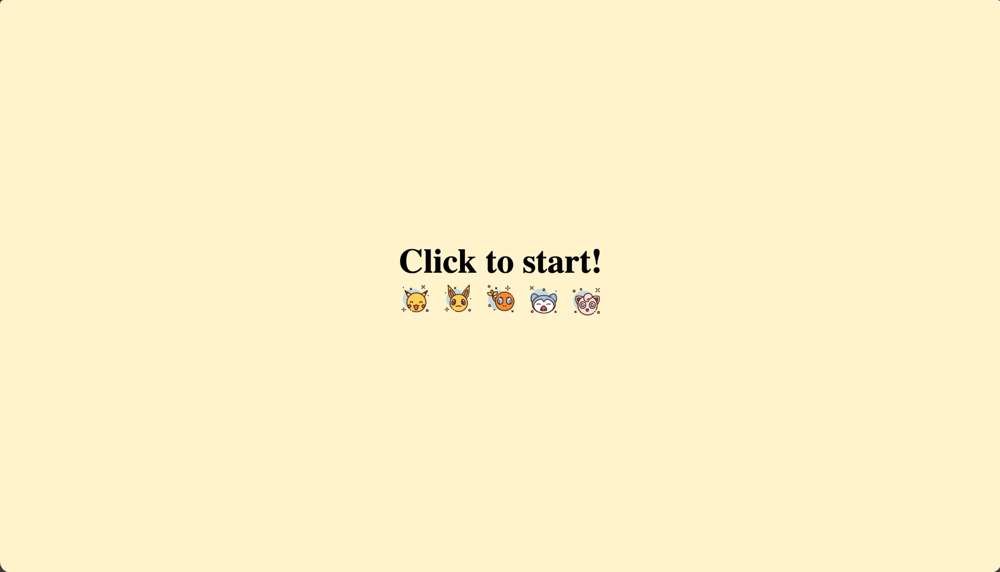
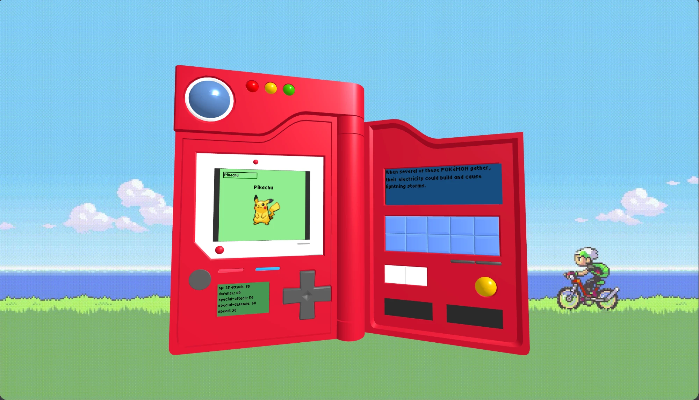

# Pokedex-3D

A 3D Pokédex in the browser, built with [Three.js](https://threejs.org/) and the [PokéAPI](https://pokeapi.co/).

Type a Pokémon's name into the Pokédex screen and it looks it up on PokéAPI. The screens on the 3D model then show its sprite, its base stats and its Pokédex entry. Littleroot Town music plays in the background, and an animated Pokémon Emerald landscape fills the scene behind the model.

## Screenshots

**Start screen**



**The Pokédex**



## Features

- A 3D Pokédex model loaded with `GLTFLoader`
- Live Pokémon data from PokéAPI: name, sprite, base stats and flavor text
- HTML screens placed onto the model's screens with `CSS3DRenderer`
- `OrbitControls` with limited rotation and zoom, so you can look around the Pokédex without losing it
- Looping background music (Littleroot Town), which starts when you click the start screen
- Animated Pokémon Emerald background

## Tech stack

- [Three.js](https://threejs.org/)
- [Vite](https://vite.dev/)
- [PokéAPI](https://pokeapi.co/)

## Getting started

```bash
cd Pokedex_API
npm install
npm install three
npm run dev
```

Then open the local URL that Vite prints (usually http://localhost:5173), click **Click to start!** and search for a Pokémon.

## Project structure

```
Pokedex_API/
├── index.html
├── public/Models/
│   ├── pokedex.glb        # 3D Pokédex model
│   └── assets/            # background gif, music, sprites
└── src/
    ├── main.js            # scene, camera, controls, model loading, music
    ├── pokedex.js         # PokéAPI requests and screen content
    └── style.css
```

## Credits

Thank you to everyone whose work helped make this project:

- **3D model:** the Pokédex model by its creator on Sketchfab: https://skfb.ly/p7rIZ. Thank you for sharing it!
- **Background:** [Pokémon Emerald Horizon Live Wallpaper](https://www.desktophut.com/Pokemon-Emerald-Horizon-Live-Wallpaper) from DesktopHut, which I converted to a GIF.
- **Colors:** picked with [HTML CSS Color](https://www.htmlcsscolor.com/hex/53DA7B).
- **IMG:** [Pokemon img here](https://www.flaticon.com/search?word=pokemon) from Flaticon.
- **Pokémon data:** [PokéAPI](https://pokeapi.co/).
- **YouTube guides:** thank you to the creators of these tutorials:
  - https://www.youtube.com/watch?v=tdsQwuyS6DQ
  - https://www.youtube.com/watch?v=aOQuuotM-Ww

## Disclaimer

Pokémon and all related names and images are trademarks of Nintendo, Game Freak and The Pokémon Company. This is a non-commercial fan project.
